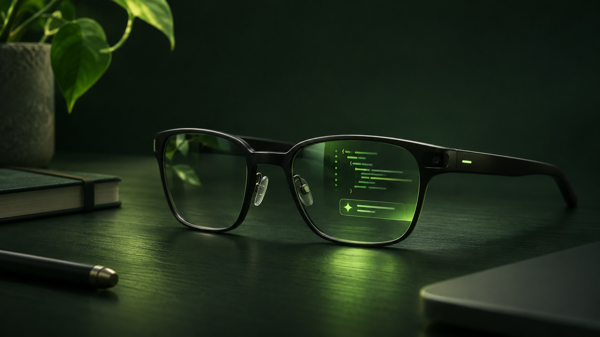

Ursprünglich erschienen bei [OpenAgentix News](https://blog.openagentix.si/de/posts/wearables-and-coding-agents/).

*KI-generierte Konzeptillustration; kein Foto und keine Abbildung eines fertigen Produkts.*

Ein Coding-Agent arbeitet manchmal minutenlang, während ich nicht am Schreibtisch sitze. Interessant ist nicht immer erst das Ergebnis. Manchmal braucht er zwischendurch eine Antwort, eine Freigabe oder möchte nur kurz mitteilen, was passiert ist. Heute bedeutet das meist: zurück zum Terminal oder das Smartphone öffnen.

Ich glaube, Wearables könnten solche kleinen Interaktionen weniger unterbrechend machen. Ein Blick zeigt, wo eine Entscheidung wartet; eine Geste bewegt sich durch die Auswahl; eine kurze diktierte Antwort schickt den Agenten zurück an die Arbeit. Das ist meine persönliche Einschätzung und keine Behauptung, dass Brillen den Bildschirm von Entwicklern ersetzen werden.

## Vom Bildschirm zum kurzen Blick

Die eigentliche Entwicklung bleibt am Schreibtisch: Diffs prüfen, Dateien vergleichen und komplizierte Befehle verstehen gehört auf einen richtigen Bildschirm. Ein Wearable ist auf einer anderen Ebene hilfreich: **Was hat sich geändert, was wartet und was sollte ich als Nächstes tun?**

Eine gute Oberfläche lässt mich durch letzte Unterhaltungen navigieren, ein Projekt auswählen, die neueste Antwort lesen und eine unterstützte Anfrage ausdrücklich erlauben oder ablehnen. Ich kann selbst antworten oder einen vorgeschlagenen Text übernehmen, ohne dass er ungefragt gesendet wird. Auf einem kleinen Display sind wenige Schritte und ein klar erkennbarer Fokus wichtiger als jede einzelne Kennzahl eines Dashboards.

Meta beschreibt Web-Apps für Ray-Ban Display als Anwendungen mit HTML, CSS und JavaScript. Das zugehörige Entwickler-Toolkit zeigt, wie vertraute Web-Technologien ein Wearable-Display erreichen können; welche Funktionen tatsächlich verfügbar sind, hängt weiter von Gerät und Plattform ab. [Metas Web-App-Toolkit](https://github.com/meta/meta-wearables-webapp)

## Warum OpenGlassUI?

[OpenGlassUI](https://github.com/weisser-dev/openglassui) ist mein experimenteller Open-Source-Versuch, diese Idee auszuprobieren. Ein lokaler Begleiter läuft auf einem Rechner oder Server neben den Coding-Agenten. Eine gekoppelte Wearable-Oberfläche kann unterstützte Unterhaltungen anzeigen und Steuerung anbieten, während der Agent selbst Modellverbindung, Werkzeuge und Berechtigungen verwaltet.

Das Projekt enthält eigene Integrationen für Codex, Claude Code, Kiro CLI und OpenCode sowie Unterstützung für konfigurierbare Agenten über das Agent Client Protocol. Die Möglichkeiten unterscheiden sich je nach Agent und Sitzung: Eine Funktion aus einer Integration ist nicht automatisch überall verfügbar. Maßgeblich sind die [Unterstützungsmatrix und aktuellen Einschränkungen](https://github.com/weisser-dev/openglassui#readme) im Repository.

OpenGlassUI ist ein Prototyp und kein Versprechen für nahtlose Fernsteuerung. Importierte Sitzungen aus anderen Clients, externe Freigaben, Live-Aktivität, Benachrichtigungen und Gerätekompatibilität haben wichtige Grenzen. Einzelne Abläufe wurden auf echter Hardware ausprobiert, aber vollständige Ende-zu-Ende-Abläufe sind nicht auf allen Geräten verifiziert. Auch lokaler oder entfernter Zugriff muss sorgfältig eingerichtet werden. Vor der Nutzung einer konkreten Funktion lohnt sich ein Blick in den aktuellen Projektstand.

## Vertrauen und Aufmerksamkeit sind die eigentliche Aufgabe

Ein Assistent direkt vor den Augen muss sich Unterbrechungen verdienen. Er sollte den Ursprung einer Nachricht zeigen, Berechtigungen verständlich machen, Freigaben nie automatisch erteilen und die Verbindung jederzeit abschaltbar halten. Wird Gesprächskontext für Vorschläge an einen Anbieter geschickt, erhält dieser Anbieter die Daten; lokale Software bedeutet nicht automatisch ein vollständig lokales Modell.

Außerdem gehört nicht jede Tätigkeit auf ein Wearable. Unkontrollierbare Benachrichtigungen, winzige Codeblöcke, unklare Verbindungen und falsch interpretierte Freigaben würden die Erfahrung verschlechtern. Sprache und Gesten brauchen Alternativen. Und beim Einsatz von Kameras und Mikrofonen verdienen Menschen in der Umgebung Rücksicht.

## Eine Oberfläche, mit der sich experimentieren lohnt

Die Chance liegt aus meiner Sicht nicht darin, einen kleineren Laptop vor dem Gesicht zu tragen. Interessant ist eine ruhigere Möglichkeit, einen Menschen einzubeziehen, während ein Agent anderswo arbeitet. Die Brille sollte die Entscheidung zeigen und danach wieder in den Hintergrund treten.

OpenAgentix ist eine Sammlung privater, nicht kommerzieller Open-Source-Experimente von [weisser-dev](https://github.com/weisser-dev). [OpenGlassUI entdecken](https://github.com/weisser-dev/openglassui), den Code ansehen und selbst entscheiden, ob die Richtung hilfreich ist. Das Projekt ist unabhängig von Meta und den Anbietern der Coding-Agenten.

## Quellen

- Meta, [Meta Wearables Web App AI Toolkit](https://github.com/meta/meta-wearables-webapp), Repository, abgerufen am 14. November 2026.
- OpenGlassUI, [README und Unterstützungsmatrix](https://github.com/weisser-dev/openglassui#readme), Repository, abgerufen am 14. November 2026.
- Agent Client Protocol, [Introduction](https://agentclientprotocol.com/overview/introduction), abgerufen am 14. November 2026.
