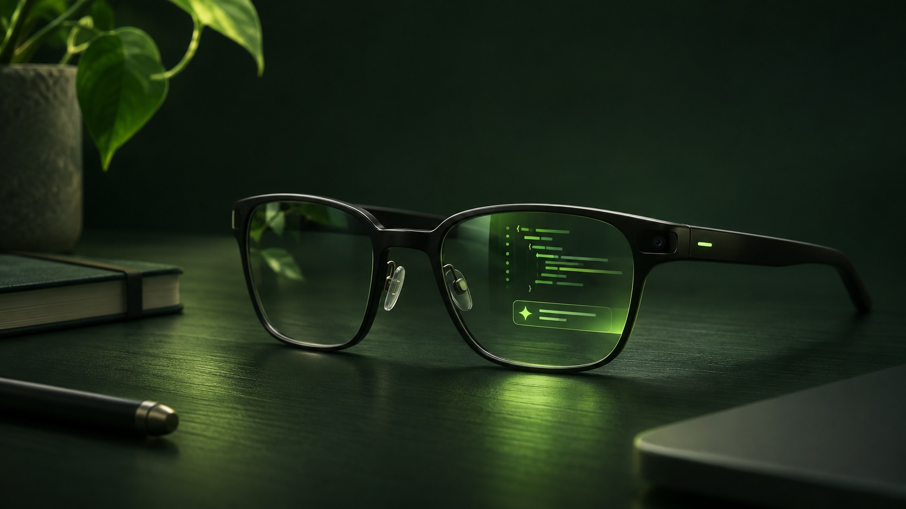

Originally published on [OpenAgentix News](https://blog.openagentix.si/posts/wearables-and-coding-agents/).

*AI-generated concept illustration; it is not a photograph or a depiction of a shipped product.*

A coding agent may work for minutes while I am away from my desk. The interesting moment is not always its final answer. Sometimes it is a question, a permission request, or a brief update that needs my attention. Today that usually means returning to a terminal or opening a phone.

I think wearables could make those small interactions feel less disruptive. A glance can show what needs a decision; a gesture can move between choices; a short dictated response can send the agent back to work. This is a personal prediction, not a claim that glasses will replace a developer's screen.

## From a screen to a glance

Traditional development remains at the desk: inspecting diffs, comparing files and reviewing complicated commands deserve a proper display. A wearable is useful at a different scale: **what changed, what is waiting, and what should I do next?**

A good interface would let me move through recent conversations, select a project, see the latest output and explicitly approve or reject a supported request. It would help me respond in my own words or choose a suggested reply without silently sending it. For a small display, fewer steps and clearly visible focus matter more than packing in every dashboard metric.

Meta describes web apps for Ray-Ban Display as HTML, CSS and JavaScript applications. Its developer toolkit is one example of how familiar web technologies can reach a wearable display; capabilities and behavior still depend on the device and platform. [Meta's web-app toolkit](https://github.com/meta/meta-wearables-webapp)

## Why build OpenGlassUI?

[OpenGlassUI](https://github.com/weisser-dev/openglassui) is my experimental open-source attempt at this idea. A local companion runs alongside coding-agent tools on a computer or server. A paired wearable interface can show supported conversations and offer controls, while the agent harness continues to own its model connection, tools and permissions.

The project has dedicated integrations for Codex, Claude Code, Kiro CLI and OpenCode, as well as support for configurable agents using the Agent Client Protocol. Capabilities vary by agent and session: a feature visible in one integration is not necessarily available in another. See the repository's [support matrix and current limitations](https://github.com/weisser-dev/openglassui#readme).

OpenGlassUI is a prototype, not a promise of seamless remote control. Imported sessions from another client, external approvals, live activity, wearable notifications and device compatibility have important limitations. Some flows have been exercised on real hardware, but complete end-to-end behavior has not been verified across devices. Local or remote exposure also needs careful configuration. Check the repository before relying on any particular feature.

## Trust and attention are the hard parts

An assistant close to your eyes should earn the right to interrupt. It should show where a message came from, make permissions explicit, avoid automatic approvals, and let the wearer choose when to disconnect. Conversation context sent to a provider for suggestions is still shared with that provider; local software is not the same as a completely local model.

I also do not think every activity belongs on a wearable. Notifications that cannot be controlled, tiny unreadable code blocks, unclear connections and a headset that guesses the wrong permission would make the experience worse. Speech and gestures need alternatives, and people nearby deserve consideration when cameras and microphones are involved.

## An interface worth experimenting with

The opportunity, as I see it, is not a smaller laptop on your face. It is a quieter way to keep a human in the loop while an agent works elsewhere. The glasses should surface the decision and then get out of the way.

OpenAgentix is a collection of private, non-commercial open-source experiments by [weisser-dev](https://github.com/weisser-dev). [Browse OpenGlassUI](https://github.com/weisser-dev/openglassui), inspect the code and decide whether this direction is useful to you. It is independent of Meta and the agent providers.

## Sources

- Meta, [Meta Wearables Web App AI Toolkit](https://github.com/meta/meta-wearables-webapp), repository, accessed 14 November 2026.
- OpenGlassUI, [README and support matrix](https://github.com/weisser-dev/openglassui#readme), repository, accessed 14 November 2026.
- Agent Client Protocol, [Introduction](https://agentclientprotocol.com/overview/introduction), accessed 14 November 2026.
