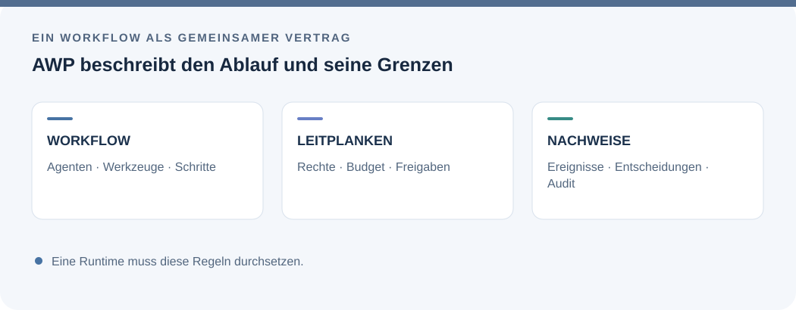
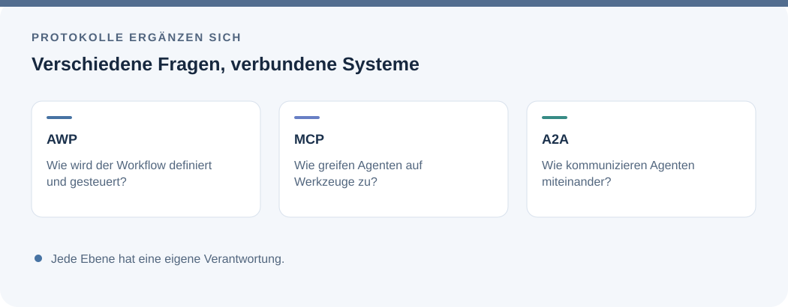
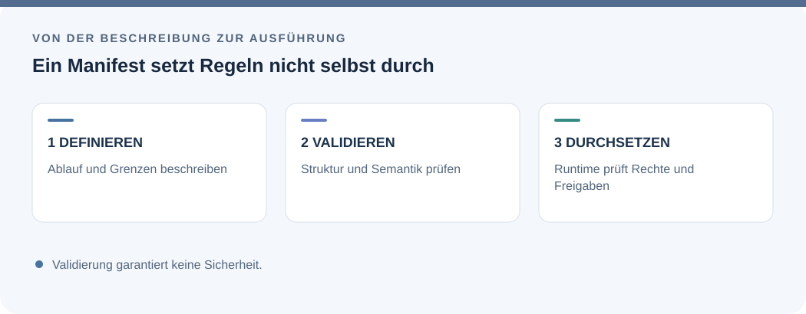

Ein Agent kann in einer Demo beeindrucken und trotzdem schwer als Teil eines größeren Systems zu betreiben sein. Welche Werkzeuge darf er nutzen? Was darf er ausgeben? Wer verantwortet den Workflow und wann muss ein Mensch einen Schritt freigeben? Diese Fragen werden schwieriger, wenn die Antworten über Prompts, Code und plattformspezifische Konfigurationen verteilt sind.

Das [Agentic Workflow Protocol (AWP)](https://agenticworkflowprotocol.org/) habe ich als persönliches Projekt begonnen, um eine explizitere Beschreibung agentischer Workflows zu erproben. Die Idee ist, den Ablauf, seine Grenzen und seine Governance in einer maschinenlesbaren Beschreibung zusammenzubringen, die Menschen und Werkzeuge prüfen können.

## Eine Beschreibung, keine weitere Agentenplattform

AWP ist eine offene Spezifikation, keine Runtime und keine gehostete Plattform. Eine Workflow-Beschreibung kann Agenten, Werkzeuge und Schritte ebenso abbilden wie Budgets, Berechtigungen, Umgebungen, Verantwortlichkeiten, Risiken und menschliche Freigaben. Sie beschreibt auch Informationen, die Implementierungen für Audit und Nachvollziehbarkeit aufzeichnen können.

Der Unterschied ist wichtig: **Eine Berechtigung oder ein Budget in einem Dokument wird nicht von selbst durchgesetzt.** Eine Runtime muss die Regeln interpretieren und durchsetzen. Teams müssen weiterhin die Implementierung testen, Zugriffe verwalten und entscheiden, welche Vorgaben gelten. AWP allein macht ein System nicht compliant.

## Das Verhältnis zu MCP und A2A

Für mich ergänzen sich diese Ebenen. MCP bietet eine Möglichkeit, Agenten mit Werkzeugen und Ressourcen zu verbinden; A2A befasst sich mit der Kommunikation zwischen Agenten. AWP konzentriert sich auf die Beschreibung des umgebenden Workflows: Was soll geschehen, unter welchen Grenzen und was soll aufgezeichnet werden? Wie die Integration konkret funktioniert, hängt von der jeweiligen Implementierung ab. Eine automatische Zusammenarbeit beliebiger Komponenten ist damit nicht versprochen.

## Warum Grenzen ausdrücklich beschreiben?

Ein Beispiel ist ein Workflow, der ein Repository untersucht und eine Korrektur vorschlägt. Wer die Konfiguration prüft, sollte verfügbare Werkzeuge, Laufzeitgrenzen und Freigaben finden können, ohne sie aus einem langen Prompt rekonstruieren zu müssen. Ein Validator kann prüfen helfen, ob eine Beschreibung dem Schema entspricht; er kann nicht garantieren, dass der Workflow sicher ist oder die Runtime sich korrekt verhält.

Gerade bei der teamübergreifenden Diskussion von Agentensystemen finde ich das hilfreich: Architektur, Sicherheit und Betrieb bekommen ein gemeinsames Artefakt, das sie hinterfragen und verbessern können. Das ist ein Ansatz für das Problem, nicht der einzig mögliche.

## Früher Stand und nächste Schritte

AWP ist **ein Entwurf im Alpha-Stadium**. Formate und Semantik können sich ändern; das Projekt verspricht noch keine produktionsreife Interoperabilität. Das Repository enthält die Arbeit an der Spezifikation und Konformitätsmaterial; ein Editor und ein Validator sind ebenfalls verfügbar. Vor Experimenten lohnt sich ein Blick in die aktuelle Projektdokumentation zu unterstützten Versionen und Einschränkungen.

Ein verwandter [Beitrag bei OpenAgentix News über Classifier-Modelle und Autonomiestufen](https://blog.openagentix.si/de/posts/classifier-models-and-autonomy-levels/) behandelt eine Governance-Frage aus diesem Umfeld. Für das Protokoll selbst sind die [AWP-Website](https://agenticworkflowprotocol.org/) und das [Quellcode-Repository](https://github.com/agenticworkflowprotocol/agenticworkflowprotocol.org) gute Einstiegspunkte. Feedback und Beiträge sind willkommen.

## Quellen

- Agentic Workflow Protocol, [Projekt-Repository und README](https://github.com/agenticworkflowprotocol/agenticworkflowprotocol.org), abgerufen am 25. November 2026.
- OpenAgentix News, [Classifier-Modelle und Autonomiestufen](https://blog.openagentix.si/de/posts/classifier-models-and-autonomy-levels/), abgerufen am 25. November 2026.
